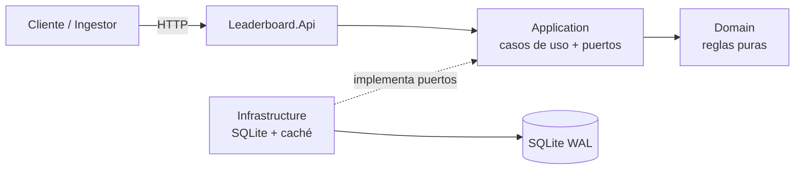
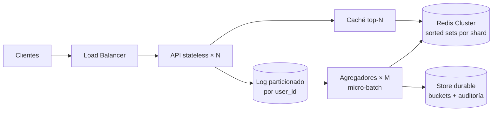

# SOLUTION: Leaderboard Service

<!--
GUÍA GENERAL
- README = "cómo lo ejecuto". SOLUTION = "por qué está hecho así, qué garantiza y cómo crece".
- Cada afirmación necesita evidencia: un test, una métrica o un cálculo.
- Llenar sección por sección al cerrar cada fase; no dejarlo para el final.
- Borrar los comentarios GUÍA antes de entregar.
-->

## 1. Resumen ejecutivo

<!-- GUÍA: 5–8 líneas. Enfoque, garantías principales, decisión clave de persistencia, qué demuestra el prototipo. -->

_TBD_

---

## 2. Supuestos y ambigüedades resueltas

<!-- GUÍA: el evaluador busca que hayas visto las ambigüedades del enunciado. Una fila por decisión. -->

| # | Ambigüedad | Decisión | Razón | Alternativa descartada |
|---|---|---|---|---|
| 1 | El payload no trae id de evento → reintentos duplican score | `Idempotency-Key` opcional; si falta, hash SHA-256 de `(user_id, score, timestamp UTC)`. Prefijos `k:`/`h:` separan ambos espacios ([ADR-002](docs/ADR/002-idempotencia-de-escritura.md)) | Exactamente-una-vez sin romper el contrato del enunciado | Key obligatoria (rompe contrato); sin idempotencia (duplica) |
| 2 | `timestamp`: ¿tiempo de evento o de ingesta? | Tiempo de evento, normalizado a UTC | El ranking refleja cuándo ocurrió la jugada, no cuándo llegó; los reintentos tardíos no cambian de bucket | Tiempo de ingesta (sesgado por colas y reintentos) |
| 3 | Eventos futuros / tardíos | Futuro > `FutureSkewTolerance` (5 min) → rechazo; tardío → se acepta y va a su bucket histórico | Tolera relojes desincronizados sin permitir inflar la ventana futura; lo tardío no se pierde del histórico | Rechazar tardíos (pierde datos legítimos) |
| 4 | `GET /user/:id/score`: ¿ventana o histórico? | Ambos en la respuesta (`windowScore`, `allTimeScore`), junto con los límites de la ventana | Elimina la ambigüedad sin obligar a elegir; cuesta una sola consulta | Devolver solo uno de los dos |
| 5 | Usuario inexistente | `404` si nunca envió puntuaciones; `200` con `windowScore = 0` si existe pero no tiene actividad en la ventana | Distingue un error de tipeo de un cero real | Siempre `200` con 0 (oculta errores del cliente) |
| 6 | Tipo de `score` | Entero `long` en `[0, MaxPointsPerEvent]` (1.000.000 por defecto); sin negativos; sumas con `checked` | Sin errores de redondeo; el tope limita el abuso y hace imposible el overflow práctico; penalizaciones quedan fuera de alcance | `double`; permitir negativos |
| 7 | Empates en el ranking | score desc, `user_id` asc (ordinal); rank = posición | Orden total → determinismo, tests estables y merge exacto de top-N entre shards | Rank denso con empates compartidos (complica paginación y merge) |
| 7b | Formato de `user_id` | 1–64 caracteres `[A-Za-z0-9_.-]`, sensible a mayúsculas | Seguro en claves, logs y URLs sin escape; acota la memoria por clave | Texto libre (riesgo de inyección y cardinalidad sin límite) |
| 8 | Límite de `top` | Default 10, máximo 100 (configurables, validados al arrancar); fuera de rango → error `top.out_of_range` | Acota el tamaño de respuesta y el costo de la consulta | Sin límite |

---

## 3. Arquitectura

<!-- GUÍA: resumen + diagrama principal. El detalle (flujos) va en docs/ARCHITECTURE.md. -->

Arquitectura hexagonal ligera en 4 proyectos. Regla de dependencias: `Api → Application → Domain`, `Infrastructure → Application`. Domain no depende de nada.

Detalle de componentes y flujos: [docs/ARCHITECTURE.md](docs/ARCHITECTURE.md)

---

## 4. Modelo de datos y lógica de agregación

<!-- GUÍA: tablas, bucketización, por qué sumar buckets y no eventos. Incluir un ejemplo numérico. -->

### Tablas

| Tabla | Propósito | Clave |
|---|---|---|
| `score_events` | Log append-only, auditoría, idempotencia (permite reconstruir los agregados) | `event_id` |
| `score_buckets` | Agregado por usuario y bucket temporal | `(user_id, bucket_start)` + índice cubriente `(bucket_start, user_id, total)` |
| `user_totals` | Total histórico por usuario | `user_id` |

Esquema en `src/Leaderboard.Infrastructure/Sqlite/SqliteDatabase.cs`. Detalles:

- Los instantes se guardan como **ticks UTC (`INTEGER`)**: exactos, compactos y comparados numéricamente, sin las trampas de comparar fechas como texto.
- `CHECK (typeof(total) = 'integer')` convierte el overflow silencioso de SQLite (que pasa de INTEGER a REAL) en un error explícito que revierte la transacción.
- `WITHOUT ROWID` en las tablas de agregados: la clave primaria es el índice agrupado, así que no hay una búsqueda adicional.

### Agregación por ventana

Detalle y alternativas: [ADR-003](docs/ADR/003-agregacion-por-buckets-temporales.md).

- Cada evento suma sus puntos al bucket `(user_id, floor(timestamp_utc, BucketSize))`.
- La ventana es `[Start, End)` alineada a buckets: `End` = fin del bucket actual y `Start = End − Window`. Siempre incluye el instante actual y cubre exactamente `Window / BucketSize` buckets.
- **Costo acotado:** 7 días con buckets de 1 minuto son como máximo 10.080 buckets por usuario, sin importar cuántos eventos haya.
- **Precisión:** el borde antiguo avanza en saltos de `BucketSize` (1 min). Es aceptable para un ranking semanal.
- `WindowAggregation.Totals` (dominio) es la especificación ejecutable; el adaptador SQL debe producir el mismo resultado.
- **Top-N:** heap acotado de tamaño N (`PriorityQueue`), O(U log N) en tiempo y O(N) en memoria para U usuarios, en lugar de ordenar todos.

### Ejemplo

Configuración por defecto (ventana de 7 días, bucket de 1 min), `now = 2026-10-15T12:00:30Z`:

| Evento (`timestamp`) | Bucket | ¿En ventana `[2026-10-08T12:01Z, 2026-10-15T12:01Z)`? |
|---|---|---|
| alice +10 @ `2026-10-15T12:00:10Z` | `12:00` | Sí |
| alice +15 @ `2026-10-14T08:00:00Z` | `08:00` | Sí |
| alice +100 @ `2026-10-08T12:00:59Z` | `2026-10-08T12:00` | No (un minuto antes de `Start`) |
| bob +7 @ `2026-10-10T00:00:00Z` | `00:00` | Sí |

Resultado: `alice = 25`, `bob = 7` (histórico de alice = 125).

---

## 5. Consistencia y garantías

<!-- GUÍA: sección clave para un perfil senior. Ser explícito en lo que SÍ y lo que NO se garantiza, con evidencia. -->

### Se garantiza

| Garantía | Mecanismo | Evidencia (test) |
|---|---|---|
| Una escritura confirmada es durable | `COMMIT` en WAL con `synchronous = FULL` (sobrevive a cortes de energía, no solo a caídas del proceso) | `Append_new_event_returns_created` |
| Cada evento se cuenta exactamente una vez | `event_id` como clave primaria + `INSERT … ON CONFLICT DO NOTHING`; el incremento solo ocurre si la inserción afectó una fila, en la misma transacción | `Append_same_event_twice_counts_once`, `Concurrent_retries_of_the_same_event_are_counted_exactly_once` (500 reintentos paralelos → 1 `Created`) |
| Sin actualizaciones perdidas bajo concurrencia | Transacción `BEGIN IMMEDIATE` + incremento en SQL (`total = total + excluded.total`), nunca leer-sumar-escribir en la aplicación | `Concurrent_writes_to_the_same_user_lose_no_updates` (1.000 escrituras paralelas al mismo usuario → suma exacta) |
| Sin estados intermedios visibles | Evento, bucket y total se confirman en una transacción; cada lectura es una sola sentencia → un único snapshot WAL | `Readers_never_observe_a_partially_applied_write` (lectores concurrentes nunca ven `windowScore ≠ allTimeScore`) |
| Lectura-tras-escritura (un nodo, sin caché) | La lectura posterior a un `COMMIT` ve sus efectos | Tests de integración del store |
| SQL equivalente al dominio | El adaptador se compara contra `WindowAggregation` + `Ranking` | `Sql_aggregation_matches_the_domain_reference_implementation` (2.000 eventos aleatorios, ~10 % duplicados) |

**De dónde viene realmente la exactitud.** En SQLite, `BEGIN IMMEDIATE` ya serializa a los escritores. Se verificó deshabilitando el semáforo de escritura: los tests de concurrencia siguen pasando. Cada mecanismo cumple un papel distinto:

- **Transacción:** atomicidad del trío evento + bucket + total.
- **Incremento en SQL:** el mismo patrón sigue siendo correcto en motores con READ COMMITTED (Postgres), donde leer-sumar-escribir perdería actualizaciones.
- **Semáforo en proceso:** optimización. Evita reintentos por bloqueo entre escritores del mismo proceso; `busy_timeout` cubre a escritores de otros procesos.

### NO se garantiza

- **Orden global de eventos:** la suma es conmutativa, así que el orden de llegada no afecta el resultado.
- **Deduplicación de eventos legítimamente idénticos sin `Idempotency-Key`:** mismo usuario, puntos e instante cuentan una vez ([ADR-002](docs/ADR/002-idempotencia-de-escritura.md)).
- **Lectura-tras-escritura en `GET /leaderboard`:** puede estar desfasado hasta `CacheTtl` (1 s). `GET /user/{id}/score` no se cachea y sí refleja de inmediato las escrituras propias.
- **Escalado de escritura horizontal:** SQLite admite un solo escritor (ver sección 8).

### Frescura (near-real-time)

- **Escritura → agregado:** inmediato. El bucket y el total se actualizan en la misma transacción que el evento; no hay un job asíncrono intermedio.
- **Agregado → `GET /leaderboard`:** obsolescencia máxima = `CacheTtl` (1 s por defecto). La respuesta incluye `generated_at` (momento real de lectura), así que el cliente puede medirla. Detalle: [ADR-004](docs/ADR/004-cache-del-leaderboard.md).
- **Por qué 1 s:** un humano no percibe un retraso de 1 s en un ranking, y acota la carga de lectura sobre el store a ~1 consulta/s por cada `top` distinto, sin importar el tráfico.

---

## 6. Hot keys: puntos de contención

<!-- GUÍA: identificar los 4 puntos; implementar al menos uno y documentar el resto. -->

| Punto de contención | Síntoma | Mitigación | ¿Implementado? |
|---|---|---|---|
| Usuario con muchas escrituras (fila/bucket caliente) | Contención de locks, latencia de escritura | Prototipo: escritores serializados en proceso (sin lock thrashing). Producción: micro-batching que fusiona incrementos del mismo `(user, bucket)`; counter sharding | Parcial (semáforo de escritura; probado con 1.000 escrituras a un solo usuario) |
| Lectura del top-N global | Recalcular el mismo resultado miles de veces; estampida cuando expira la caché | `HybridCache` con TTL de 1 s y la ventana en la clave; los misses concurrentes se coalescen en una sola consulta ([ADR-004](docs/ADR/004-cache-del-leaderboard.md)) | **Sí** (50 peticiones concurrentes → 1 consulta) |
| Sorted set global único (producción, Redis) | Un shard saturado | Particionar por hash de `user_id` en K sets; top-N global = merge de top-N por shard. Es exacto porque el orden es total (`Ranking`) | No (diseño) |
| Bucket temporal actual | Todas las escrituras caen en el mismo rango de tiempo | Clave primaria `(user_id, bucket_start)`: la contención se reparte por usuario, nunca por tiempo | **Sí** (esquema) |
| Rate limiting por cliente | Un cliente ruidoso satura al resto | Token bucket por API key (o por IP sin key) | **Sí** |

---

## 7. Trade-offs

<!-- GUÍA: formato "elegí X, cedí Y, a cambio de Z". -->

| Decisión | Elegí | Cedí | A cambio de |
|---|---|---|---|
| Persistencia del prototipo | SQLite WAL | Escalado horizontal, múltiples escritores | Cero dependencias, ejecutable con un comando |
| Acceso a datos | Dapper + SQL explícito | Productividad de EF Core | Visibilidad total del incremento atómico |
| Escritura | Síncrona: el `2xx` se responde después del `COMMIT` | Throughput (un `fsync` por evento con `synchronous = FULL`) | Garantía simple y honesta: lo confirmado está en disco |
| Durabilidad | `synchronous = FULL` | Throughput de escritura: un `fsync` por commit, que `NORMAL` en WAL evitaría (pendiente de medir) | No perder escrituras confirmadas ante un corte de energía |
| Formato de tiempo | Ticks UTC `INTEGER` | Legibilidad directa en la base de datos | Comparación exacta y numérica; sin ambigüedad de zona horaria |
| Leaderboard | Caché TTL corto | Frescura absoluta | Protección ante hot key de lectura |

---

## 8. Escalado a 100k req/s

<!-- GUÍA: NÚMEROS con supuestos explícitos. Un cálculo con supuestos declarados es defendible. -->

### Supuestos

| Supuesto | Valor |
|---|---|
| Ratio escritura/lectura | _TBD_ |
| Tamaño medio de evento | ~200 B |
| Capacidad por nodo API | _TBD req/s_ |
| Capacidad por shard Redis (con margen) | _TBD ops/s_ |
| Distribución de usuarios (activos, hot users) | _TBD_ |

### Cálculos

| Componente | Cálculo | Resultado |
|---|---|---|
| Ancho de banda de ingesta | 100.000 × 200 B | ~20 MB/s |
| Eventos por día | 100.000 × 86.400 | ~8,6 mil millones |
| Nodos API | _TBD_ | _TBD_ |
| Particiones del log | _TBD_ | _TBD_ |
| Shards de Redis | _TBD_ | _TBD_ |
| Almacenamiento de buckets | _TBD_ | _TBD_ |

### Arquitectura objetivo

### Qué escala y cómo

_TBD_

### Cuellos de botella

_TBD_

---

## 9. Latencia y throughput

Medido con `tests/Leaderboard.E2ETests` (cliente HTTP real, latencia vista por el cliente) el 2026-10-15, en un portátil con Windows 11, sobre .NET 10 en Release dentro del contenedor y Debug en el proceso local. Son números de un prototipo en una sola máquina, útiles para entender el comportamiento, **no** un benchmark de capacidad.

**Proceso local (Windows, SSD, Kestrel directo):**

| Escenario | Concurrencia | Throughput | p50 | p95 | p99 | 5xx |
|---|---|---|---|---|---|---|
| `POST /score` (30 % hot user, 5 % reintentos) | 64 | 389 req/s | 124.8 ms | 301.4 ms | 864.9 ms | 0 |
| `POST /score` (mismo escenario) | 1 | 67 req/s | 5.6 ms | 64.7 ms | 177.1 ms | 0 |
| `POST /score` concurrente con lecturas | 32 | 334 req/s | 67.3 ms | 177.6 ms | 412.2 ms | 0 |
| `GET /leaderboard?top=10` durante escrituras | 8 lectores | 20.563 req/s | 0.3 ms | 0.5 ms | 1.3 ms | 0 |
| `GET /user/{id}/score` | 64 | 16.112 req/s | 0.8 ms | 13.3 ms | 16.6 ms | 0 |

**Contenedor Docker (Docker Desktop, volumen en el disco virtual de WSL2):**

| Escenario | Concurrencia | Throughput | p50 | p95 | p99 | 5xx |
|---|---|---|---|---|---|---|
| `POST /score` (30 % hot user, 5 % reintentos) | 64 | 120 req/s | 237.4 ms | 1479.6 ms | 9998.2 ms | 0 |
| `POST /score` concurrente con lecturas | 32 | 113 req/s | 163.6 ms | 939.4 ms | 3218.1 ms | 0 |
| `GET /leaderboard?top=10` durante escrituras | 8 lectores | 7.385 req/s | 0.9 ms | 1.6 ms | 2.7 ms | 0 |
| `GET /user/{id}/score` | 64 | 3.942 req/s | 1.7 ms | 79.1 ms | 90.3 ms | 0 |

En todas las ejecuciones la correctitud fue total: los 501 totales por usuario coincidieron exactamente con lo esperado, los 200 reintentos idénticos sumaron una sola vez, y los lectores nunca vieron un leaderboard mal formado.

**Interpretación:**

- **El cuello de botella es el `fsync` por commit con un único escritor.** El servicio en sí es rápido: con concurrencia 1, el p50 es 5.6 ms incluyendo el `fsync`. Con 64 clientes, la latencia es casi toda cola, como predice la ley de Little: 64 / 389 req/s ≈ 165 ms de espera media frente al p50 medido de 125 ms. El throughput sube con la concurrencia (67 → 389 req/s) porque se solapan el procesamiento HTTP y la espera del lock.
- **En Docker Desktop**, el `fsync` sobre el disco virtual de WSL2 es varias veces más caro (~120 commits/s). Con 64 clientes, la cola llega a un p99 de ~10 s. La cola de latencias del disco (`fsync` lentos esporádicos) se amplifica porque todos los escritores esperan detrás del mismo lock.
- **Las lecturas no compiten con las escrituras:** gracias a WAL y a la caché, `GET /leaderboard` sostiene más de 20k req/s con p99 de 1.3 ms mientras se escribe.
- **Mejora concreta de mayor impacto, aún no implementada:** *group commit*. Agrupar en una sola transacción y un solo `fsync` los eventos que llegan durante 1–5 ms (micro-batching con `Channel<T>`, respondiendo a cada cliente después del commit de su lote) multiplicaría el throughput de escritura por el tamaño del lote, sin debilitar la garantía de durabilidad. Es la misma idea que el diseño de producción (§8) aplica con un log y agregadores.

| Métrica | Prototipo (medido, proceso local) | Producción (proyectado, §8) |
|---|---|---|
| p50 `POST /score` | 5.6 ms sin cola / 125 ms con 64 clientes | < 10 ms (ack tras escribir en el log replicado) |
| p99 `POST /score` | 865 ms con 64 clientes | < 50 ms |
| p99 `GET /leaderboard` | 1.3 ms | < 5 ms (caché en proceso + L2) |
| Throughput de escritura | ~390 req/s (un escritor, `fsync` por evento) | 100k req/s (escalado horizontal) |

---

## 10. Seguridad

<!-- GUÍA: auth, validación, rate limits, secretos, contenedor, modelo de amenazas. -->

- **Autenticación:** header `X-Api-Key`, comparado en tiempo constante sobre digests SHA-256 (no revela por tiempo ni el contenido ni la longitud de la key). **Falla cerrada:** sin keys configuradas, todo responde `401`. Las keys de `appsettings.Development.json` son solo de desarrollo; en otros entornos se inyectan por variable de entorno o gestor de secretos.
- **Autorización:** roles por key: `scores:write` (ingestores, server-to-server) y `scores:read` (lectores). Una key de solo lectura no puede escribir (`403`). Evidencia: `SecurityTests`.
- **Validación de entrada:** en el dominio, con todos los errores reportados a la vez: `user_id` con charset y longitud acotados (evita inyección y cardinalidad sin límite), puntos enteros con tope, `timestamp` sin futuro más allá del skew e `Idempotency-Key` ASCII imprimible de hasta 128 caracteres. JSON mal formado → `400` problem+json.
- **Rate limiting:** token bucket por API key (por IP si no hay key), con `500 req/s` sostenidos y ráfagas de `1000` (configurable). Responde `429` con `Retry-After`. Va después de la autenticación para particionar por cliente.
- **Límites de payload:** `MaxRequestBodySize = 16 KB` en Kestrel (el payload real pesa menos de 200 B).
- **Errores:** RFC 9457 con `trace_id`; nunca se exponen stack traces ni detalles internos.
- **Secretos:** fuera del repositorio en todos los entornos salvo Development. En producción: gestor de secretos (Key Vault o Secrets Manager) con rotación. Las keys deberían guardarse hasheadas.
- **Contenedor:** imagen chiseled (sin shell ni gestor de paquetes) y usuario no-root por defecto.
- **Modelo de amenazas:**

| Amenaza | Mitigación |
|---|---|
| Fabricación de puntuaciones por clientes finales | Solo ingestores server-to-server con rol `scores:write`. Producción: firmar eventos en el servidor del juego (HMAC) y aplicar reglas anti-cheat aguas arriba |
| Inflar la ventana con timestamps futuros | Rechazo más allá de `FutureSkewTolerance` |
| Repetición (replay) de peticiones | Idempotencia por `event_id` |
| Fuerza bruta o enumeración de keys | Comparación en tiempo constante + rate limit por IP para peticiones sin key |
| DoS por payloads grandes o `top` enorme | Límite de body (16 KB) y `MaxTop` = 100 |
| Exposición de `/metrics` | Pública en el prototipo; en producción, solo red interna o protegida |

---

## 11. Observabilidad

<!-- GUÍA: métricas, logs, trazas, SLOs y alertas. -->

| Señal | Detalle |
|---|---|
| Métricas | OpenTelemetry → Prometheus en `/metrics`. HTTP (RED) automáticas: `http_server_request_duration_seconds` por ruta y código. De negocio: `leaderboard_scores_ingested_total{outcome=created\|duplicate\|rejected}` |
| Logs | JSON estructurado en consola (fuera de Development) con scopes (`TraceId`, `SpanId`), listo para Loki o ELK |
| Trazas | OpenTelemetry con instrumentación ASP.NET Core; se exportan por OTLP si se configura `Telemetry:OtlpEndpoint` (Jaeger, Tempo, etc.) |
| Correlación | Header `X-Correlation-Id` (= trace id) en todas las respuestas; `trace_id` en cada problem+json |
| Health checks | `/health/live` (proceso vivo, sin dependencias) y `/health/ready` (SQLite accesible y esquema creado). Separarlos evita reinicios en cascada cuando falla una dependencia |

**SLOs propuestos:**

| SLI | Objetivo |
|---|---|
| Disponibilidad de `POST /score` (respuestas no-5xx) | 99,9 % mensual |
| Latencia p99 de `POST /score` | < 50 ms |
| Latencia p99 de `GET /leaderboard` | < 20 ms (servido de caché) |
| Frescura del leaderboard | < 2 s (TTL de 1 s + margen) |

**Alertas** (burn rate sobre los SLOs, no sobre síntomas aislados):

- La tasa de 5xx consume el presupuesto de error más de 14× más rápido de lo normal en 1 h (página) o más de 6× en 6 h (ticket).
- p99 de `POST /score` > 50 ms durante 10 min.
- `rate(leaderboard_scores_ingested_total{outcome="rejected"})` / total > 5 %: probable integración rota en un cliente.
- `outcome="duplicate"` anómalamente alto: un cliente está reintentando en bucle.
- `/health/ready` falla en más del 50 % de las réplicas.

---

## 12. Despliegue

<!-- GUÍA: pipeline, estrategia (canary/rolling), migraciones expand/contract. -->

_TBD_

---

## 13. Rollback y recuperación

<!-- GUÍA: criterios de rollback, procedimiento, reconstrucción de agregados, RPO/RTO. -->

_TBD_

---

## 14. Limitaciones conocidas y trabajo futuro

_TBD_

---

## 15. Uso de IA

<!-- GUÍA: dónde ayudó, dónde se corrigió/rechazó, qué decisiones son propias. -->

_TBD_. Bitácora completa: [docs/AI_LOG.md](docs/AI_LOG.md)

---

## 16. Tiempo empleado

_TBD (igual al del README; indicar si se excedieron las 6 h recomendadas y por qué)._
