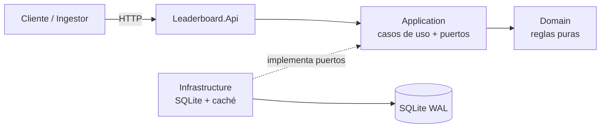
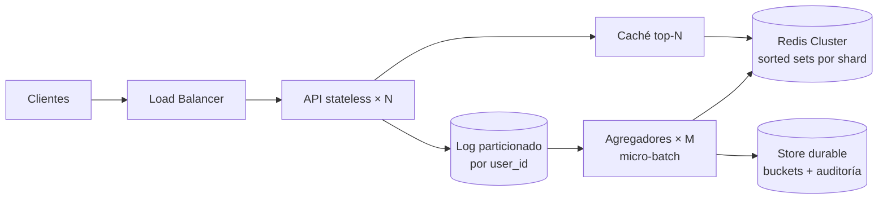

# SOLUTION: Leaderboard Service

<!--
GUÍA GENERAL
- README = "cómo lo ejecuto". SOLUTION = "por qué está hecho así, qué garantiza y cómo crece".
- Cada afirmación necesita evidencia: un test, una métrica o un cálculo.
- Llenar sección por sección al cerrar cada fase; no dejarlo para el final.
- Borrar los comentarios GUÍA antes de entregar.
-->

## 1. Resumen ejecutivo

<!-- GUÍA: 5–8 líneas. Enfoque, garantías principales, decisión clave de persistencia, qué demuestra el prototipo. -->

_TBD_

---

## 2. Supuestos y ambigüedades resueltas

<!-- GUÍA: el evaluador busca que hayas visto las ambigüedades del enunciado. Una fila por decisión. -->

| # | Ambigüedad | Decisión | Razón | Alternativa descartada |
|---|---|---|---|---|
| 1 | El payload no trae id de evento → reintentos duplican score | `Idempotency-Key` opcional; si falta, hash SHA-256 de `(user_id, score, timestamp UTC)`. Prefijos `k:`/`h:` separan ambos espacios ([ADR-002](docs/ADR/002-idempotencia-de-escritura.md)) | Exactamente-una-vez sin romper el contrato del enunciado | Key obligatoria (rompe contrato); sin idempotencia (duplica) |
| 2 | `timestamp`: ¿tiempo de evento o de ingesta? | Tiempo de evento, normalizado a UTC | El ranking refleja cuándo ocurrió la jugada, no cuándo llegó; los reintentos tardíos no cambian de bucket | Tiempo de ingesta (sesgado por colas y reintentos) |
| 3 | Eventos futuros / tardíos | Futuro > `FutureSkewTolerance` (5 min) → rechazo; tardío → se acepta y va a su bucket histórico | Tolera relojes desincronizados sin permitir inflar la ventana futura; lo tardío no se pierde del histórico | Rechazar tardíos (pierde datos legítimos) |
| 4 | `GET /user/:id/score`: ¿ventana o histórico? | Ambos en la respuesta | _TBD_ | _TBD_ |
| 5 | Usuario inexistente | _TBD: 404 o 200 con 0_ | _TBD_ | _TBD_ |
| 6 | Tipo de `score` | Entero `long` en `[0, MaxPointsPerEvent]` (1.000.000 por defecto); sin negativos; sumas con `checked` | Sin errores de redondeo; el tope limita el abuso y hace imposible el overflow práctico; penalizaciones quedan fuera de alcance | `double`; permitir negativos |
| 7 | Empates en el ranking | score desc, `user_id` asc (ordinal); rank = posición | Orden total → determinismo, tests estables y merge exacto de top-N entre shards | Rank denso con empates compartidos (complica paginación y merge) |
| 7b | Formato de `user_id` | 1–64 caracteres `[A-Za-z0-9_.-]`, sensible a mayúsculas | Seguro en claves, logs y URLs sin escape; acota la memoria por clave | Texto libre (riesgo de inyección y cardinalidad sin límite) |
| 8 | Límite de `top` | Default _TBD_, máximo _TBD_ | Proteger el servicio | Sin límite |

---

## 3. Arquitectura

<!-- GUÍA: resumen + diagrama principal. El detalle (flujos) va en docs/ARCHITECTURE.md. -->

Arquitectura hexagonal ligera en 4 proyectos. Regla de dependencias: `Api → Application → Domain`, `Infrastructure → Application`. Domain no depende de nada.

Detalle de componentes y flujos: [docs/ARCHITECTURE.md](docs/ARCHITECTURE.md)

---

## 4. Modelo de datos y lógica de agregación

<!-- GUÍA: tablas, bucketización, por qué sumar buckets y no eventos. Incluir un ejemplo numérico. -->

### Tablas

| Tabla | Propósito | Clave |
|---|---|---|
| `score_events` | Log append-only, auditoría, idempotencia | `event_id` |
| `score_buckets` | Agregado por usuario y bucket temporal | `(user_id, bucket_start)` |
| `user_totals` | Total histórico (opcional) | `user_id` |

### Agregación por ventana

Detalle y alternativas: [ADR-003](docs/ADR/003-agregacion-por-buckets-temporales.md).

- Cada evento suma sus puntos al bucket `(user_id, floor(timestamp_utc, BucketSize))`.
- La ventana es `[Start, End)` alineada a buckets: `End` = fin del bucket actual y `Start = End − Window`. Siempre incluye el instante actual y cubre exactamente `Window / BucketSize` buckets.
- **Costo acotado:** 7 días con buckets de 1 minuto son como máximo 10.080 buckets por usuario, sin importar cuántos eventos haya.
- **Precisión:** el borde antiguo avanza en saltos de `BucketSize` (1 min). Es aceptable para un ranking semanal.
- `WindowAggregation.Totals` (dominio) es la especificación ejecutable; el adaptador SQL debe producir el mismo resultado.
- **Top-N:** heap acotado de tamaño N (`PriorityQueue`), O(U log N) en tiempo y O(N) en memoria para U usuarios, en lugar de ordenar todos.

### Ejemplo

Configuración por defecto (ventana de 7 días, bucket de 1 min), `now = 2026-10-15T12:00:30Z`:

| Evento (`timestamp`) | Bucket | ¿En ventana `[2026-10-08T12:01Z, 2026-10-15T12:01Z)`? |
|---|---|---|
| alice +10 @ `2026-10-15T12:00:10Z` | `12:00` | Sí |
| alice +15 @ `2026-10-14T08:00:00Z` | `08:00` | Sí |
| alice +100 @ `2026-10-08T12:00:59Z` | `2026-10-08T12:00` | No (un minuto antes de `Start`) |
| bob +7 @ `2026-10-10T00:00:00Z` | `00:00` | Sí |

Resultado: `alice = 25`, `bob = 7` (histórico de alice = 125).

---

## 5. Consistencia y garantías

<!-- GUÍA: sección clave para un perfil senior. Ser explícito en lo que SÍ y lo que NO se garantiza, con evidencia. -->

### Se garantiza

| Garantía | Mecanismo | Evidencia (test) |
|---|---|---|
| Una escritura con `2xx` es durable | Transacción SQLite (WAL) | _TBD_ |
| Cada evento se cuenta exactamente una vez | `event_id` único + `INSERT OR IGNORE` en la misma transacción que el incremento | _TBD_ |
| Sin actualizaciones perdidas bajo concurrencia | Incremento atómico en SQL (sin read-modify-write en la app) | _TBD_ |
| Lectura-tras-escritura (un nodo) | _TBD_ | _TBD_ |

### NO se garantiza

- _TBD: orden global de eventos_
- _TBD: deduplicación de eventos idénticos legítimos sin `Idempotency-Key`_
- _TBD: frescura < TTL de caché en el leaderboard_

### Frescura (near-real-time)

_TBD: obsolescencia máxima del leaderboard = TTL de caché. Justificar valor._

---

## 6. Hot keys: puntos de contención

<!-- GUÍA: identificar los 4 puntos; implementar al menos uno y documentar el resto. -->

| Punto de contención | Síntoma | Mitigación | ¿Implementado? |
|---|---|---|---|
| Usuario con muchas escrituras (fila/bucket caliente) | Contención de locks, latencia de escritura | Micro-batching que fusiona incrementos; counter sharding | _TBD_ |
| Lectura del top-N global | Recalcular el mismo resultado miles de veces | Caché con TTL corto + protección contra estampida (`HybridCache`) | _TBD_ |
| Sorted set global único (producción, Redis) | Un shard saturado | Particionar por hash de `user_id` en K sets; top-N global = merge de top-N por shard (exacto) | No (diseño) |
| Bucket temporal actual | Todas las escrituras en el mismo rango | Clave `(user_id, bucket)`; repartir por usuario, no por tiempo | _TBD_ |

---

## 7. Trade-offs

<!-- GUÍA: formato "elegí X, cedí Y, a cambio de Z". -->

| Decisión | Elegí | Cedí | A cambio de |
|---|---|---|---|
| Persistencia del prototipo | SQLite WAL | Escalado horizontal, múltiples escritores | Cero dependencias, ejecutable con un comando |
| Acceso a datos | Dapper + SQL explícito | Productividad de EF Core | Visibilidad total del incremento atómico |
| Escritura | _TBD: síncrona vs micro-batch_ | _TBD_ | _TBD_ |
| Leaderboard | Caché TTL corto | Frescura absoluta | Protección ante hot key de lectura |

---

## 8. Escalado a 100k req/s

<!-- GUÍA: NÚMEROS con supuestos explícitos. Un cálculo con supuestos declarados es defendible. -->

### Supuestos

| Supuesto | Valor |
|---|---|
| Ratio escritura/lectura | _TBD_ |
| Tamaño medio de evento | ~200 B |
| Capacidad por nodo API | _TBD req/s_ |
| Capacidad por shard Redis (con margen) | _TBD ops/s_ |
| Distribución de usuarios (activos, hot users) | _TBD_ |

### Cálculos

| Componente | Cálculo | Resultado |
|---|---|---|
| Ancho de banda de ingesta | 100.000 × 200 B | ~20 MB/s |
| Eventos por día | 100.000 × 86.400 | ~8,6 mil millones |
| Nodos API | _TBD_ | _TBD_ |
| Particiones del log | _TBD_ | _TBD_ |
| Shards de Redis | _TBD_ | _TBD_ |
| Almacenamiento de buckets | _TBD_ | _TBD_ |

### Arquitectura objetivo

### Qué escala y cómo

_TBD_

### Cuellos de botella

_TBD_

---

## 9. Latencia y throughput

<!-- GUÍA: medido en local (aunque sea con el test E2E) + proyección en producción. -->

| Métrica | Local (medido) | Producción (proyectado) |
|---|---|---|
| p50 `POST /score` | _TBD_ | _TBD_ |
| p99 `POST /score` | _TBD_ | _TBD_ |
| p99 `GET /leaderboard` | _TBD_ | _TBD_ |
| Throughput de escritura | _TBD_ | 100k req/s |

---

## 10. Seguridad

<!-- GUÍA: auth, validación, rate limits, secretos, contenedor, modelo de amenazas. -->

- **Autenticación:** _TBD_
- **Autorización:** _TBD (p. ej. clave de ingestor vs. clave de lectura)_
- **Validación de entrada:** _TBD_
- **Rate limiting:** _TBD_
- **Límites de payload:** _TBD_
- **Secretos:** _TBD_
- **Contenedor:** _TBD (no-root, imagen mínima)_
- **Modelo de amenazas:** _TBD (fabricación de scores, enumeración de usuarios, DoS)_

---

## 11. Observabilidad

<!-- GUÍA: métricas, logs, trazas, SLOs y alertas. -->

| Señal | Detalle |
|---|---|
| Métricas | _TBD_ |
| Logs | _TBD_ |
| Trazas | _TBD_ |
| Health checks | _TBD_ |

**SLOs propuestos:** _TBD_

**Alertas:** _TBD_

---

## 12. Despliegue

<!-- GUÍA: pipeline, estrategia (canary/rolling), migraciones expand/contract. -->

_TBD_

---

## 13. Rollback y recuperación

<!-- GUÍA: criterios de rollback, procedimiento, reconstrucción de agregados, RPO/RTO. -->

_TBD_

---

## 14. Limitaciones conocidas y trabajo futuro

_TBD_

---

## 15. Uso de IA

<!-- GUÍA: dónde ayudó, dónde se corrigió/rechazó, qué decisiones son propias. -->

_TBD_. Bitácora completa: [docs/AI_LOG.md](docs/AI_LOG.md)

---

## 16. Tiempo empleado

_TBD (igual al del README; indicar si se excedieron las 6 h recomendadas y por qué)._
