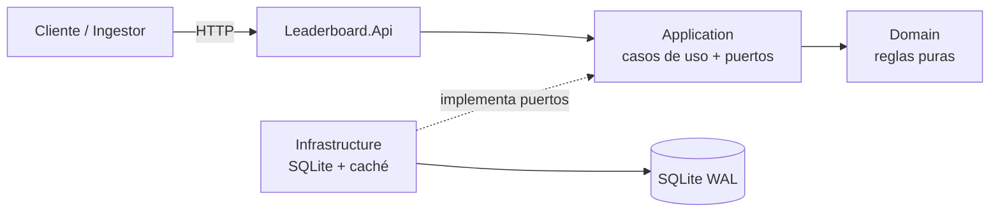
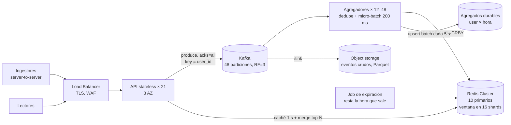
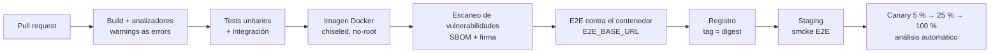

# SOLUTION: Leaderboard Service

<!--
GUÍA GENERAL
- README = "cómo lo ejecuto". SOLUTION = "por qué está hecho así, qué garantiza y cómo crece".
- Cada afirmación necesita evidencia: un test, una métrica o un cálculo.
- Llenar sección por sección al cerrar cada fase; no dejarlo para el final.
- Borrar los comentarios GUÍA antes de entregar.
-->

## 1. Resumen ejecutivo

Servicio .NET 10 de leaderboard global con **arquitectura hexagonal ligera**: un dominio puro (ventana, buckets, idempotencia, ranking) separado de la persistencia mediante puertos. La agregación por ventana es **incremental por buckets de tiempo alineados**: cada lectura cuesta como máximo `Window / BucketSize` buckets por usuario, sin importar el volumen de eventos.

**La escritura es exactamente-una-vez y atómica.** Cada evento tiene una identidad (`Idempotency-Key` o hash del payload) y se inserta junto con sus agregados en una sola transacción SQLite (`BEGIN IMMEDIATE`, incremento en SQL). Se probó con 1.000 escrituras concurrentes al mismo usuario, 500 reintentos idénticos y lectores concurrentes que nunca ven estados intermedios.

**El leaderboard es near-real-time** con obsolescencia acotada y visible (caché de 1 s con coalescencia; `generated_at` en la respuesta). Seguridad y operación están incluidas: API keys con roles, rate limit por cliente, errores RFC 9457 con códigos estables, health, métricas Prometheus y trazas OpenTelemetry.

Se eligió **SQLite** para que se ejecute con un solo comando. Su límite (un escritor, ~390 escrituras/s medidas) está documentado, y §8 dimensiona con números la arquitectura de **100k req/s**: log particionado, agregadores con micro-batch y Redis Cluster con leaderboard particionado y merge exacto. Esa arquitectura reutiliza el mismo dominio y los mismos puertos.

La evidencia son **128 tests automatizados** (84 unitarios, 39 de integración y 5 E2E contra el servicio real, también en Docker), con latencias reales medidas en §9.

---

## 2. Supuestos y ambigüedades resueltas

<!-- GUÍA: el evaluador busca que hayas visto las ambigüedades del enunciado. Una fila por decisión. -->

| # | Ambigüedad | Decisión | Razón | Alternativa descartada |
|---|---|---|---|---|
| 1 | El payload no trae id de evento → reintentos duplican score | `Idempotency-Key` opcional; si falta, hash SHA-256 de `(user_id, score, timestamp UTC)`. Prefijos `k:`/`h:` separan ambos espacios ([ADR-002](docs/ADR/002-idempotencia-de-escritura.md)) | Exactamente-una-vez sin romper el contrato del enunciado | Key obligatoria (rompe contrato); sin idempotencia (duplica) |
| 2 | `timestamp`: ¿tiempo de evento o de ingesta? | Tiempo de evento, normalizado a UTC | El ranking refleja cuándo ocurrió la jugada, no cuándo llegó; los reintentos tardíos no cambian de bucket | Tiempo de ingesta (sesgado por colas y reintentos) |
| 3 | Eventos futuros / tardíos | Futuro > `FutureSkewTolerance` (5 min) → rechazo; tardío → se acepta y va a su bucket histórico | Tolera relojes desincronizados sin permitir inflar la ventana futura; lo tardío no se pierde del histórico | Rechazar tardíos (pierde datos legítimos) |
| 4 | `GET /user/:id/score`: ¿ventana o histórico? | Ambos en la respuesta (`windowScore`, `allTimeScore`), junto con los límites de la ventana | Elimina la ambigüedad sin obligar a elegir; cuesta una sola consulta | Devolver solo uno de los dos |
| 5 | Usuario inexistente | `404` si nunca envió puntuaciones; `200` con `windowScore = 0` si existe pero no tiene actividad en la ventana | Distingue un error de tipeo de un cero real | Siempre `200` con 0 (oculta errores del cliente) |
| 6 | Tipo de `score` | Entero `long` en `[0, MaxPointsPerEvent]` (1.000.000 por defecto); sin negativos; sumas con `checked` | Sin errores de redondeo; el tope limita el abuso y hace imposible el overflow práctico; penalizaciones quedan fuera de alcance | `double`; permitir negativos |
| 7 | Empates en el ranking | score desc, `user_id` asc (ordinal); rank = posición | Orden total → determinismo, tests estables y merge exacto de top-N entre shards | Rank denso con empates compartidos (complica paginación y merge) |
| 7b | Formato de `user_id` | 1–64 caracteres `[A-Za-z0-9_.-]`, sensible a mayúsculas | Seguro en claves, logs y URLs sin escape; acota la memoria por clave | Texto libre (riesgo de inyección y cardinalidad sin límite) |
| 8 | Límite de `top` | Default 10, máximo 100 (configurables, validados al arrancar); fuera de rango → error `top.out_of_range` | Acota el tamaño de respuesta y el costo de la consulta | Sin límite |

---

## 3. Arquitectura

<!-- GUÍA: resumen + diagrama principal. El detalle (flujos) va en docs/ARCHITECTURE.md. -->

Arquitectura hexagonal ligera en 4 proyectos. Regla de dependencias: `Api → Application → Domain`, `Infrastructure → Application`. Domain no depende de nada.

Detalle de componentes y flujos: [docs/ARCHITECTURE.md](docs/ARCHITECTURE.md)

---

## 4. Modelo de datos y lógica de agregación

<!-- GUÍA: tablas, bucketización, por qué sumar buckets y no eventos. Incluir un ejemplo numérico. -->

### Tablas

| Tabla | Propósito | Clave |
|---|---|---|
| `score_events` | Log append-only, auditoría, idempotencia (permite reconstruir los agregados) | `event_id` |
| `score_buckets` | Agregado por usuario y bucket temporal | `(user_id, bucket_start)` + índice cubriente `(bucket_start, user_id, total)` |
| `user_totals` | Total histórico por usuario | `user_id` |

Esquema en `src/Leaderboard.Infrastructure/Sqlite/SqliteDatabase.cs`. Detalles:

- Los instantes se guardan como **ticks UTC (`INTEGER`)**: exactos, compactos y comparados numéricamente, sin las trampas de comparar fechas como texto.
- `CHECK (typeof(total) = 'integer')` convierte el overflow silencioso de SQLite (que pasa de INTEGER a REAL) en un error explícito que revierte la transacción.
- `WITHOUT ROWID` en las tablas de agregados: la clave primaria es el índice agrupado, así que no hay una búsqueda adicional.

### Agregación por ventana

Detalle y alternativas: [ADR-003](docs/ADR/003-agregacion-por-buckets-temporales.md).

- Cada evento suma sus puntos al bucket `(user_id, floor(timestamp_utc, BucketSize))`.
- La ventana es `[Start, End)` alineada a buckets: `End` = fin del bucket actual y `Start = End − Window`. Siempre incluye el instante actual y cubre exactamente `Window / BucketSize` buckets.
- **Costo acotado:** 7 días con buckets de 1 minuto son como máximo 10.080 buckets por usuario, sin importar cuántos eventos haya.
- **Precisión:** el borde antiguo avanza en saltos de `BucketSize` (1 min). Es aceptable para un ranking semanal.
- `WindowAggregation.Totals` (dominio) es la especificación ejecutable; el adaptador SQL debe producir el mismo resultado.
- **Top-N:** heap acotado de tamaño N (`PriorityQueue`), O(U log N) en tiempo y O(N) en memoria para U usuarios, en lugar de ordenar todos.

### Ejemplo

Configuración por defecto (ventana de 7 días, bucket de 1 min), `now = 2026-10-15T12:00:30Z`:

| Evento (`timestamp`) | Bucket | ¿En ventana `[2026-10-08T12:01Z, 2026-10-15T12:01Z)`? |
|---|---|---|
| alice +10 @ `2026-10-15T12:00:10Z` | `12:00` | Sí |
| alice +15 @ `2026-10-14T08:00:00Z` | `08:00` | Sí |
| alice +100 @ `2026-10-08T12:00:59Z` | `2026-10-08T12:00` | No (un minuto antes de `Start`) |
| bob +7 @ `2026-10-10T00:00:00Z` | `00:00` | Sí |

Resultado: `alice = 25`, `bob = 7` (histórico de alice = 125).

---

## 5. Consistencia y garantías

<!-- GUÍA: sección clave para un perfil senior. Ser explícito en lo que SÍ y lo que NO se garantiza, con evidencia. -->

### Se garantiza

| Garantía | Mecanismo | Evidencia (test) |
|---|---|---|
| Una escritura confirmada es durable | `COMMIT` en WAL con `synchronous = FULL` (sobrevive a cortes de energía, no solo a caídas del proceso) | `Append_new_event_returns_created` |
| Cada evento se cuenta exactamente una vez | `event_id` como clave primaria + `INSERT … ON CONFLICT DO NOTHING`; el incremento solo ocurre si la inserción afectó una fila, en la misma transacción | `Append_same_event_twice_counts_once`, `Concurrent_retries_of_the_same_event_are_counted_exactly_once` (500 reintentos paralelos → 1 `Created`) |
| Sin actualizaciones perdidas bajo concurrencia | Transacción `BEGIN IMMEDIATE` + incremento en SQL (`total = total + excluded.total`), nunca leer-sumar-escribir en la aplicación | `Concurrent_writes_to_the_same_user_lose_no_updates` (1.000 escrituras paralelas al mismo usuario → suma exacta) |
| Sin estados intermedios visibles | Evento, bucket y total se confirman en una transacción; cada lectura es una sola sentencia → un único snapshot WAL | `Readers_never_observe_a_partially_applied_write` (lectores concurrentes nunca ven `windowScore ≠ allTimeScore`) |
| Lectura-tras-escritura (un nodo, sin caché) | La lectura posterior a un `COMMIT` ve sus efectos | Tests de integración del store |
| SQL equivalente al dominio | El adaptador se compara contra `WindowAggregation` + `Ranking` | `Sql_aggregation_matches_the_domain_reference_implementation` (2.000 eventos aleatorios, ~10 % duplicados) |

**De dónde viene realmente la exactitud.** En SQLite, `BEGIN IMMEDIATE` ya serializa a los escritores. Se verificó deshabilitando el semáforo de escritura: los tests de concurrencia siguen pasando. Cada mecanismo cumple un papel distinto:

- **Transacción:** atomicidad del trío evento + bucket + total.
- **Incremento en SQL:** el mismo patrón sigue siendo correcto en motores con READ COMMITTED (Postgres), donde leer-sumar-escribir perdería actualizaciones.
- **Semáforo en proceso:** optimización. Evita reintentos por bloqueo entre escritores del mismo proceso; `busy_timeout` cubre a escritores de otros procesos.

### NO se garantiza

- **Orden global de eventos:** la suma es conmutativa, así que el orden de llegada no afecta el resultado.
- **Deduplicación de eventos legítimamente idénticos sin `Idempotency-Key`:** mismo usuario, puntos e instante cuentan una vez ([ADR-002](docs/ADR/002-idempotencia-de-escritura.md)).
- **Lectura-tras-escritura en `GET /leaderboard`:** puede estar desfasado hasta `CacheTtl` (1 s). `GET /user/{id}/score` no se cachea y sí refleja de inmediato las escrituras propias.
- **Escalado de escritura horizontal:** SQLite admite un solo escritor (ver sección 8).

### Frescura (near-real-time)

- **Escritura → agregado:** inmediato. El bucket y el total se actualizan en la misma transacción que el evento; no hay un job asíncrono intermedio.
- **Agregado → `GET /leaderboard`:** obsolescencia máxima = `CacheTtl` (1 s por defecto). La respuesta incluye `generated_at` (momento real de lectura), así que el cliente puede medirla. Detalle: [ADR-004](docs/ADR/004-cache-del-leaderboard.md).
- **Por qué 1 s:** un humano no percibe un retraso de 1 s en un ranking, y acota la carga de lectura sobre el store a ~1 consulta/s por cada `top` distinto, sin importar el tráfico.

---

## 6. Hot keys: puntos de contención

<!-- GUÍA: identificar los 4 puntos; implementar al menos uno y documentar el resto. -->

| Punto de contención | Síntoma | Mitigación | ¿Implementado? |
|---|---|---|---|
| Usuario con muchas escrituras (fila/bucket caliente) | Contención de locks, latencia de escritura | Prototipo: escritores serializados en proceso (sin lock thrashing). Producción: micro-batching que fusiona incrementos del mismo `(user, bucket)`; counter sharding | Parcial (semáforo de escritura; probado con 1.000 escrituras a un solo usuario) |
| Lectura del top-N global | Recalcular el mismo resultado miles de veces; estampida cuando expira la caché | `HybridCache` con TTL de 1 s y la ventana en la clave; los misses concurrentes se coalescen en una sola consulta ([ADR-004](docs/ADR/004-cache-del-leaderboard.md)) | **Sí** (50 peticiones concurrentes → 1 consulta) |
| Sorted set global único (producción, Redis) | Un shard saturado | Particionar por hash de `user_id` en K sets; top-N global = merge de top-N por shard. Es exacto porque el orden es total (`Ranking`) | No (diseño) |
| Bucket temporal actual | Todas las escrituras caen en el mismo rango de tiempo | Clave primaria `(user_id, bucket_start)`: la contención se reparte por usuario, nunca por tiempo | **Sí** (esquema) |
| Rate limiting por cliente | Un cliente ruidoso satura al resto | Token bucket por API key (o por IP sin key) | **Sí** |

---

## 7. Trade-offs

<!-- GUÍA: formato "elegí X, cedí Y, a cambio de Z". -->

| Decisión | Elegí | Cedí | A cambio de |
|---|---|---|---|
| Persistencia del prototipo | SQLite WAL | Escalado horizontal, múltiples escritores | Cero dependencias, ejecutable con un comando |
| Acceso a datos | Dapper + SQL explícito | Productividad de EF Core | Visibilidad total del incremento atómico |
| Escritura | Síncrona: el `2xx` se responde después del `COMMIT` | Throughput (un `fsync` por evento con `synchronous = FULL`) | Garantía simple y honesta: lo confirmado está en disco |
| Durabilidad | `synchronous = FULL` | Throughput de escritura: un `fsync` por commit, que `NORMAL` en WAL evitaría (pendiente de medir) | No perder escrituras confirmadas ante un corte de energía |
| Formato de tiempo | Ticks UTC `INTEGER` | Legibilidad directa en la base de datos | Comparación exacta y numérica; sin ambigüedad de zona horaria |
| Leaderboard | Caché TTL corto | Frescura absoluta | Protección ante hot key de lectura |

---

## 8. Escalado a 100k req/s

### Por qué el prototipo no escala así y qué se conserva

El prototipo está limitado por diseño a **un escritor SQLite con un `fsync` por evento**: ~390 escrituras/s medidas (§9), unas 250 veces menos que el objetivo. No se escala "poniendo más SQLite". Lo que **sí se conserva** son las decisiones que hacen correcta la solución, porque no dependen del almacén:

- **Identidad del evento (`EventId`) e idempotencia por clave.**
- **Agregación incremental por `(user, bucket)`:** nunca se suman eventos crudos al leer.
- **Orden total del ranking:** permite particionar el leaderboard y fusionar los top-N de forma exacta.
- **Puertos `IScoreWriteStore` / `ILeaderboardReadStore`:** producción cambia los adaptadores (productor de Kafka, lector de Redis) sin tocar el dominio ni los casos de uso.

### Supuestos

Se dimensiona para el **peor caso: 100k escrituras/s sostenidas en pico**. Las lecturas se dimensionan aparte porque la caché las desacopla.

| Supuesto | Valor | Justificación |
|---|---|---|
| Carga de diseño | 100k `POST /score`/s en pico + hasta 50k lecturas/s | Las escrituras son el camino caro; las lecturas se sirven de caché |
| Tamaño del request HTTP | ~300 B (body + headers) | Payload de ~120 B + headers con API key |
| Tamaño del evento en el log | ~150 B | `user_id` ≤ 64, `event_id` ~66, puntos y timestamp 16, overhead |
| Usuarios | 10M registrados, ~1M activos por hora | Orden de magnitud de un juego mediano-grande |
| Hot user | Hasta 5 % del tráfico (5k eventos/s de un solo usuario) | Bots, streamers, torneos |
| Capacidad por pod API (4 vCPU) | 8k req/s a < 60 % de CPU | Conservador: el prototipo sirve más de 20k lecturas/s en un portátil con cliente y servidor en la misma máquina |
| Capacidad por partición del log | ≤ 5 MB/s y ~10k eventos/s por consumidor | Límites prácticos conservadores de Kafka y de un agregador |
| Capacidad por primario de Redis | ~100k ops/s; se planifica al **40 %** (40k ops/s) | Margen para picos, failover y comandos O(log N) |
| Ventana de deduplicación | 6 h | Los reintentos reales ocurren en segundos o minutos |

### Cálculos

| Componente | Cálculo | Resultado |
|---|---|---|
| Tráfico de entrada en el balanceador | 100.000 × 300 B | **30 MB/s** (~240 Mbps) |
| Escritura en el log | 100.000 × 150 B | **15 MB/s**; con replicación ×3 → 45 MB/s |
| Eventos por día | 100.000 × 86.400 | **8,64 × 10⁹** |
| Retención del log (24 h, para replay) | 15 MB/s × 86.400 s × 3 réplicas | **~3,9 TB** en el clúster (6 brokers × ~650 GB) |
| Pods API | 100k / 8k = 12,5 → tolerar la caída de una zona: 3 AZ × 7 = 21; sin una AZ: 14 × 8k = 112k ≥ 100k | **21 pods** (HPA entre 15 y 30) |
| Particiones del log | max(100k / 10k, 15 MB/s / 5 MB/s) = 10 → ×4 de margen (repartir después rompe la localidad por `user_id`) | **48 particiones** |
| Agregadores | ≤ 1 consumidor por partición; 100k / 12 ≈ 8,3k eventos/s por pod | **12 pods** (escalables hasta 48) |
| Ops Redis de escritura | 3 ops por evento (`HINCRBY` del bucket horario, `ZINCRBY` en la ventana, `HINCRBY` del total) × 100k. El micro-batch de 200 ms solo reduce esto en las claves calientes, así que se planifica sin reducción | **300k ops/s** |
| Ops Redis de lectura | `GET /user`: 2 ops × 50k/s = 100k; `GET /leaderboard`: 21 pods × ~3 valores de `top` × 16 shards × 1/s ≈ 1k | **~100k ops/s** |
| Primarios de Redis | (300k + 100k) / 40k | **10 primarios + 10 réplicas** |
| Memoria de Redis | Ventana: 10M × ~100 B = 1 GB; buckets horarios: 168 h × 1M × ~80 B = 13 GB; totales: 10M × 80 B = 0,8 GB | **~15 GB** (~1,5 GB por primario) |
| Estado de deduplicación | 8,64 × 10⁹ / 4 (6 h) × ~80 B | **~173 GB** → ~3,6 GB por partición (RocksDB local con changelog) |
| Agregados durables | 1M usuarios activos/h × 24 × ~50 B | **~1,2 GB/día** de filas `(user, hora)` |
| Archivo de eventos crudos | 15 MB/s × 86.400 s, Parquet comprimido ~5× | **~250 GB/día** en object storage |

### Arquitectura objetivo

### Qué escala y cómo

1. **API (stateless):** escala horizontal con HPA por CPU y RPS. Valida, autentica y **produce al log**; no toca la base de datos. Responde **`202 Accepted`** con el `event_id` cuando Kafka confirma (`acks=all`, `min.insync.replicas=2`), así que la durabilidad del 2xx se mantiene. **Cambio de contrato consciente:** el prototipo responde `201` o `200` (duplicado) porque deduplica de forma síncrona. A 100k/s, deduplicar en el camino síncrono exigiría un `SET NX` previo al log, con un modo de falla peligroso: si se marca la clave y luego falla el produce, el reintento del cliente se trataría como duplicado y el evento se perdería. Se prefiere deduplicar de forma asíncrona y sin pérdida en el agregador.
2. **Log (Kafka):** particionado por `user_id`, así que todos los eventos y reintentos de un usuario caen en la misma partición. El agregador deduplica con estado local y mantiene el orden por usuario. Escala con particiones (48 desde el inicio) y brokers.
3. **Agregadores:** por partición, deduplican por `event_id` (RocksDB con TTL de 6 h), combinan en memoria los incrementos del mismo `(user, hora)` durante 200 ms y escriben en Redis con pipelining. Hacen commit del offset **después** de escribir, de modo que tras una caída reprocesan y la deduplicación evita doble conteo (efectivamente exactamente-una-vez). Escalan hasta 1 por partición.
4. **Read model (Redis Cluster):**
   - Ventana: **16 sorted sets** `lb:7d:{shard}` (shard = hash(user) mod 16) con `ZINCRBY`.
   - Buckets horarios `bucket:{hora}` (hash user → puntos) y totales `total` (hash).
   - **Expiración:** cada hora, un job resta del ZSET los puntos del bucket que sale de la ventana y luego borra el hash. Son ~1M `ZINCRBY` repartidos en 60 min ≈ 280 ops/s.
   - **Top-N:** `ZREVRANGE 0 N-1` en los 16 shards y merge. Es **exacto** gracias al orden total (`Ranking`); el test `Top_matches_a_full_sort_on_a_large_random_input` valida esa propiedad.
5. **Granularidad:** en producción, buckets **horarios** en Redis (frente a 1 minuto en el prototipo) para acotar memoria y trabajo de expiración. El borde antiguo de una ventana de 7 días tiene precisión de 1 h; la ventana es configurable por despliegue.
6. **Agregados durables:** upsert por lotes de `(user, hora, total)` cada 5 s (~40k filas/s en `COPY`). Sirven para reconstruir Redis y para el histórico. Postgres particionado por fecha, o ClickHouse (`SummingMergeTree`).
7. **Lecturas:**
   - `GET /leaderboard`: caché de 1 s por pod con coalescencia, como en el prototipo; ~1k ops/s a Redis sin importar el tráfico.
   - `GET /user`: 2 ops a Redis.
   - Opcional: caché en CDN o edge con `Cache-Control: max-age=1`.

### Cuellos de botella y mitigación

| Riesgo | Por qué | Mitigación |
|---|---|---|
| **Partición caliente** (hot user) | 5k eventos/s de un usuario van a una sola partición | El agregador combina en memoria, así que se convierten en ~5 escrituras/s a Redis. Si la partición se satura, se aplica *key salting* (`user#k`, con k = hash(event_id) mod 4) solo a los usuarios calientes detectados, conservando la deduplicación porque es determinista |
| **ZSET global único** | Una sola clave concentraría 100k ops/s en un shard | 16 shards lógicos repartidos en 10 primarios (~6k ops/s por clave) |
| **Lag de los agregadores** | Picos por encima de la capacidad de consumo | Se monitorea el lag por partición; se escala hasta 48 consumidores; la frescura tiene SLO de < 2 s |
| **Estampida de lecturas** | Mismo top-N para todos los clientes | Caché de 1 s con coalescencia por pod (implementada); CDN opcional |
| **Expiración horaria** | Restar 1M entradas de golpe al cambiar la hora | Se reparte en los 60 min siguientes (~280 ops/s) |
| **Crecimiento del estado de deduplicación** | 8,6 × 10⁹ ids/día | TTL de 6 h → ~3,6 GB por partición en disco local |
| **Particiones fijas** | Repartir rompe la localidad por usuario | Sobredimensionar desde el inicio (48); migrar con doble escritura si hiciera falta |

### Latencia esperada en producción

- **`POST`:** p50 < 10 ms, p99 < 50 ms. Ack tras la réplica en Kafka dentro de la región: 2–10 ms.
- **Frescura del leaderboard:** < 2 s (linger de 5 ms + flush de 200 ms + caché de 1 s).
- **`GET /leaderboard`:** p99 < 5 ms desde caché.

---

## 9. Latencia y throughput

Medido con `tests/Leaderboard.E2ETests` (cliente HTTP real, latencia vista por el cliente) el 2026-10-15, en un portátil con Windows 11, sobre .NET 10 en Release dentro del contenedor y Debug en el proceso local. Son números de un prototipo en una sola máquina, útiles para entender el comportamiento, **no** un benchmark de capacidad.

**Proceso local (Windows, SSD, Kestrel directo):**

| Escenario | Concurrencia | Throughput | p50 | p95 | p99 | 5xx |
|---|---|---|---|---|---|---|
| `POST /score` (30 % hot user, 5 % reintentos) | 64 | 389 req/s | 124.8 ms | 301.4 ms | 864.9 ms | 0 |
| `POST /score` (mismo escenario) | 1 | 67 req/s | 5.6 ms | 64.7 ms | 177.1 ms | 0 |
| `POST /score` concurrente con lecturas | 32 | 334 req/s | 67.3 ms | 177.6 ms | 412.2 ms | 0 |
| `GET /leaderboard?top=10` durante escrituras | 8 lectores | 20.563 req/s | 0.3 ms | 0.5 ms | 1.3 ms | 0 |
| `GET /user/{id}/score` | 64 | 16.112 req/s | 0.8 ms | 13.3 ms | 16.6 ms | 0 |

**Contenedor Docker (Docker Desktop, volumen en el disco virtual de WSL2):**

| Escenario | Concurrencia | Throughput | p50 | p95 | p99 | 5xx |
|---|---|---|---|---|---|---|
| `POST /score` (30 % hot user, 5 % reintentos) | 64 | 120 req/s | 237.4 ms | 1479.6 ms | 9998.2 ms | 0 |
| `POST /score` concurrente con lecturas | 32 | 113 req/s | 163.6 ms | 939.4 ms | 3218.1 ms | 0 |
| `GET /leaderboard?top=10` durante escrituras | 8 lectores | 7.385 req/s | 0.9 ms | 1.6 ms | 2.7 ms | 0 |
| `GET /user/{id}/score` | 64 | 3.942 req/s | 1.7 ms | 79.1 ms | 90.3 ms | 0 |

En todas las ejecuciones la correctitud fue total: los 501 totales por usuario coincidieron exactamente con lo esperado, los 200 reintentos idénticos sumaron una sola vez, y los lectores nunca vieron un leaderboard mal formado.

**Interpretación:**

- **El cuello de botella es el `fsync` por commit con un único escritor.** El servicio en sí es rápido: con concurrencia 1, el p50 es 5.6 ms incluyendo el `fsync`. Con 64 clientes, la latencia es casi toda cola, como predice la ley de Little: 64 / 389 req/s ≈ 165 ms de espera media frente al p50 medido de 125 ms. El throughput sube con la concurrencia (67 → 389 req/s) porque se solapan el procesamiento HTTP y la espera del lock.
- **En Docker Desktop**, el `fsync` sobre el disco virtual de WSL2 es varias veces más caro (~120 commits/s). Con 64 clientes, la cola llega a un p99 de ~10 s. La cola de latencias del disco (`fsync` lentos esporádicos) se amplifica porque todos los escritores esperan detrás del mismo lock.
- **Las lecturas no compiten con las escrituras:** gracias a WAL y a la caché, `GET /leaderboard` sostiene más de 20k req/s con p99 de 1.3 ms mientras se escribe.
- **Mejora concreta de mayor impacto, aún no implementada:** *group commit*. Agrupar en una sola transacción y un solo `fsync` los eventos que llegan durante 1–5 ms (micro-batching con `Channel<T>`, respondiendo a cada cliente después del commit de su lote) multiplicaría el throughput de escritura por el tamaño del lote, sin debilitar la garantía de durabilidad. Es la misma idea que el diseño de producción (§8) aplica con un log y agregadores.

| Métrica | Prototipo (medido, proceso local) | Producción (proyectado, §8) |
|---|---|---|
| p50 `POST /score` | 5.6 ms sin cola / 125 ms con 64 clientes | < 10 ms (ack tras escribir en el log replicado) |
| p99 `POST /score` | 865 ms con 64 clientes | < 50 ms |
| p99 `GET /leaderboard` | 1.3 ms | < 5 ms (caché en proceso + L2) |
| Throughput de escritura | ~390 req/s (un escritor, `fsync` por evento) | 100k req/s (escalado horizontal) |

---

## 10. Seguridad

<!-- GUÍA: auth, validación, rate limits, secretos, contenedor, modelo de amenazas. -->

- **Autenticación:** header `X-Api-Key`, comparado en tiempo constante sobre digests SHA-256 (no revela por tiempo ni el contenido ni la longitud de la key). **Falla cerrada:** sin keys configuradas, todo responde `401`. Las keys de `appsettings.Development.json` son solo de desarrollo; en otros entornos se inyectan por variable de entorno o gestor de secretos.
- **Autorización:** roles por key: `scores:write` (ingestores, server-to-server) y `scores:read` (lectores). Una key de solo lectura no puede escribir (`403`). Evidencia: `SecurityTests`.
- **Validación de entrada:** en el dominio, con todos los errores reportados a la vez: `user_id` con charset y longitud acotados (evita inyección y cardinalidad sin límite), puntos enteros con tope, `timestamp` sin futuro más allá del skew e `Idempotency-Key` ASCII imprimible de hasta 128 caracteres. JSON mal formado → `400` problem+json.
- **Rate limiting:** token bucket por API key (por IP si no hay key), con `500 req/s` sostenidos y ráfagas de `1000` (configurable). Responde `429` con `Retry-After`. Va después de la autenticación para particionar por cliente.
- **Límites de payload:** `MaxRequestBodySize = 16 KB` en Kestrel (el payload real pesa menos de 200 B).
- **Errores:** RFC 9457 con `trace_id`; nunca se exponen stack traces ni detalles internos.
- **Secretos:** fuera del repositorio en todos los entornos salvo Development. En producción: gestor de secretos (Key Vault o Secrets Manager) con rotación. Las keys deberían guardarse hasheadas.
- **Contenedor:** imagen chiseled (sin shell ni gestor de paquetes) y usuario no-root por defecto.
- **Modelo de amenazas:**

| Amenaza | Mitigación |
|---|---|
| Fabricación de puntuaciones por clientes finales | Solo ingestores server-to-server con rol `scores:write`. Producción: firmar eventos en el servidor del juego (HMAC) y aplicar reglas anti-cheat aguas arriba |
| Inflar la ventana con timestamps futuros | Rechazo más allá de `FutureSkewTolerance` |
| Repetición (replay) de peticiones | Idempotencia por `event_id` |
| Fuerza bruta o enumeración de keys | Comparación en tiempo constante + rate limit por IP para peticiones sin key |
| DoS por payloads grandes o `top` enorme | Límite de body (16 KB) y `MaxTop` = 100 |
| Exposición de `/metrics` | Pública en el prototipo; en producción, solo red interna o protegida |

---

## 11. Observabilidad

<!-- GUÍA: métricas, logs, trazas, SLOs y alertas. -->

| Señal | Detalle |
|---|---|
| Métricas | OpenTelemetry → Prometheus en `/metrics`. HTTP (RED) automáticas: `http_server_request_duration_seconds` por ruta y código. De negocio: `leaderboard_scores_ingested_total{outcome=created\|duplicate\|rejected}` |
| Logs | JSON estructurado en consola (fuera de Development) con scopes (`TraceId`, `SpanId`), listo para Loki o ELK |
| Trazas | OpenTelemetry con instrumentación ASP.NET Core; se exportan por OTLP si se configura `Telemetry:OtlpEndpoint` (Jaeger, Tempo, etc.) |
| Correlación | Header `X-Correlation-Id` (= trace id) en todas las respuestas; `trace_id` en cada problem+json |
| Health checks | `/health/live` (proceso vivo, sin dependencias) y `/health/ready` (SQLite accesible y esquema creado). Separarlos evita reinicios en cascada cuando falla una dependencia |

**SLOs propuestos:**

| SLI | Objetivo |
|---|---|
| Disponibilidad de `POST /score` (respuestas no-5xx) | 99,9 % mensual |
| Latencia p99 de `POST /score` | < 50 ms |
| Latencia p99 de `GET /leaderboard` | < 20 ms (servido de caché) |
| Frescura del leaderboard | < 2 s (TTL de 1 s + margen) |

**Alertas** (burn rate sobre los SLOs, no sobre síntomas aislados):

- La tasa de 5xx consume el presupuesto de error más de 14× más rápido de lo normal en 1 h (página) o más de 6× en 6 h (ticket).
- p99 de `POST /score` > 50 ms durante 10 min.
- `rate(leaderboard_scores_ingested_total{outcome="rejected"})` / total > 5 %: probable integración rota en un cliente.
- `outcome="duplicate"` anómalamente alto: un cliente está reintentando en bucle.
- `/health/ready` falla en más del 50 % de las réplicas.

---

## 12. Despliegue

### Pipeline (CI/CD)

1. **Cada PR:** `dotnet build` (analizadores con warnings as errors) y `dotnet test` (unitarios + integración), en menos de 1 min.
2. **Imagen:** `deploy/Dockerfile` (multi-stage, chiseled, UID 1654), escaneo de vulnerabilidades, SBOM y firma de la imagen. Se despliega siempre **por digest**, nunca por `latest`.
3. **E2E contra el contenedor:** la misma suite `tests/Leaderboard.E2ETests` con `E2E_BASE_URL`, como se hizo localmente (§9). Las E2E son agnósticas del destino, así que en staging se reutilizan como smoke tests.
4. **Despliegue progresivo (canary):** 5 % → 25 % → 100 %, con análisis automático en cada paso (Argo Rollouts o Flagger). Se aborta si, frente a la versión estable:
   - la tasa de 5xx supera el baseline en +0,5 pp;
   - el p99 de `POST /score` supera 1,5× el baseline;
   - `scores_ingested_total{outcome="rejected"}` sube más de 2× (un cambio de validación que rompe integraciones);
   - `/health/ready` falla.

### Plataforma (producción)

- **Kubernetes en 3 zonas de disponibilidad.** Readiness = `/health/ready` (sale del balanceo si no hay base de datos); liveness = `/health/live` (solo reinicia si el proceso está colgado, nunca por una dependencia caída). Incluye `PodDisruptionBudget`, HPA y `topologySpreadConstraints` por zona.
- **Configuración y secretos:** las API keys vienen del gestor de secretos (driver CSI), nunca de la imagen ni del repositorio. La configuración se gestiona con GitOps.
- **Migraciones expand/contract:** cada release solo **agrega** (columnas nullables, tablas, índices `CONCURRENTLY`). Lo que se elimina se borra en un release posterior, cuando ninguna versión desplegada lo usa. Así, la versión N-1 siempre funciona con el esquema N y el rollback de código es seguro. Las migraciones corren como Job previo al rollout.
- **Contrato de API:** cambios solo aditivos. Un cambio incompatible (como pasar de `201` a `202` en §8) va en `/v2` y se mantiene `/v1` durante la transición de los integradores.

### Despliegue del prototipo (tal como está)

SQLite es un archivo con **un único escritor**, así que el prototipo se despliega como **1 réplica con volumen persistente** (`StatefulSet` con `replicas: 1` y estrategia `Recreate`, o `docker compose`, verificado en §9). No admite rolling updates sin una breve interrupción (el pod viejo debe soltar el archivo antes de que arranque el nuevo, unos segundos). Es una limitación aceptada del prototipo; la arquitectura de §8 es stateless en la capa API.

---

## 13. Rollback y recuperación

### Rollback de código

| Disparador | Acción | Tiempo |
|---|---|---|
| El análisis del canary falla (criterios de §12) | Rollback **automático** al digest estable; el tráfico del canary vuelve a la versión anterior | < 2 min |
| Problema detectado después del 100 % | Revertir el commit de GitOps al digest anterior (o `kubectl rollout undo`) | < 5 min |
| Configuración errónea | Revertir en GitOps. Si la configuración es inválida, el servicio **ni siquiera arranca** (`ValidateOnStart`), así que el rollout se detiene solo por falta de readiness | < 5 min |

El rollback de código es seguro porque las migraciones son solo aditivas (§12): la versión anterior nunca encuentra un esquema que no entiende.

### Recuperación de datos

**El principio:** los eventos son la fuente de verdad (inmutables) y todo lo demás es **derivado y reconstruible**. En el prototipo, `score_events` permite recalcular `score_buckets` y `user_totals` con un `INSERT … SELECT … GROUP BY`. En producción, Redis se reconstruye desde los agregados durables y el replay del log.

| Escenario | Prototipo (SQLite) | Producción |
|---|---|---|
| Se cae el proceso o el pod | WAL + `synchronous=FULL`: lo confirmado no se pierde; al reiniciar, SQLite recupera el WAL | Kafka RF=3, `min.insync=2`: un broker caído no pierde acks |
| Se pierde el disco | Backup continuo con Litestream (replica el WAL a object storage). **RPO ≈ 1 s, RTO ≈ minutos** (restaurar el archivo) | Kafka replicado + PITR de Postgres (archivado de WAL). **RPO ≤ 5 min** para los agregados durables; el log cubre las últimas 24 h |
| Se corrompe o se pierde el read model (Redis) | No aplica (un solo almacén) | Reconstrucción: (1) cargar los 7 días de agregados `(user, hora)` desde Postgres (~170M filas, minutos); (2) hacer replay del log desde el último offset volcado. **RTO < 30 min**. Durante la reconstrucción, el leaderboard responde `503` o la última foto conocida; la ingesta no se detiene porque escribe en el log |
| Datos malos (un integrador envía puntajes inflados) | Marcar sus eventos como inválidos y recalcular los agregados de los usuarios afectados desde `score_events` | Igual: compensar con eventos de corrección auditables (nunca editar el historial) y reconstruir los usuarios afectados |
| Se cae una región | No aplica | Activo-pasivo con replicación del log a la región secundaria (MirrorMaker 2). **RPO de segundos a minutos, RTO < 1 h** (failover de DNS + reconstrucción de Redis) |

### Ejercicios

Los planes de recuperación que no se ensayan no funcionan. Se propone restaurar trimestralmente un backup en un entorno aislado y reconstruir Redis desde cero, midiendo el RTO real. También pruebas de caos: matar un broker, un primario de Redis o un agregador en staging.

---

## 14. Limitaciones conocidas y trabajo futuro

### Limitaciones del prototipo (conscientes)

| Limitación | Impacto | Siguiente paso |
|---|---|---|
| Un escritor SQLite con un `fsync` por evento | ~390 escrituras/s locales, ~120 en Docker Desktop; colas largas con mucha concurrencia (§9) | **Group commit:** `Channel<T>` + un escritor que confirma lotes de 1–5 ms en una transacción y responde a cada cliente después del commit de su lote. Mismo contrato y misma durabilidad, throughput ×N |
| Sin retención de `score_events` | La tabla crece sin límite | Job de retención que archiva a object storage y purga lo que exceda el máximo entre la ventana y el período de auditoría |
| Eventos idénticos sin `Idempotency-Key` se cuentan una vez | Pérdida improbable pero posible (ADR-002) | Exigir `Idempotency-Key` en `/v2` |
| Top-N recalculado sobre todos los usuarios de la ventana en cada miss de caché | Suficiente para ~10⁵ usuarios con TTL de 1 s; no para 10⁷ | Ventana materializada con resta del bucket que expira (§8) |
| Caché solo en proceso | Con varias réplicas, cada una consulta el store | L2 en Redis: `HybridCache` lo soporta sin cambiar código |
| API keys en texto plano en la configuración, sin rotación ni expiración | Riesgo operativo | Guardar hashes, rotación con solapamiento, emisión desde un gestor de secretos; o OAuth2 client credentials para integradores |
| `/metrics` público | Exposición de información operativa | Puerto o red interna, o autenticación en el scraper |
| Sin correcciones ni puntajes negativos | No se pueden revertir errores con la API | Eventos de compensación auditables (ver §13) |
| Latencias medidas en un portátil | No representan producción | Prueba de carga en staging con k6 o NBomber al tamaño de §8 |
| Buckets de 1 minuto en el prototipo, horarios en el diseño de producción | Precisión distinta del borde antiguo | Hacer el tamaño de bucket configurable por tenant y documentarlo en el contrato |

### Trabajo futuro orientado a integraciones con distintas compañías

- **Multi-tenancy:** `tenant_id` derivado de la API key (nunca del payload), leaderboards y límites por tenant, aislamiento de datos y métricas etiquetadas por tenant. Es el primer cambio necesario para ofrecer el servicio a varias compañías.
- **Contrato estable y versionado:** OpenAPI publicado (ya generado en `/openapi/v1.json`), `error_codes` estables (ya implementados) para que los integradores automaticen el manejo de errores, y deprecaciones con fecha.
- **Ingesta por lotes** (`POST /scores:batch`, hasta 1.000 eventos) para integradores de alto volumen: menos overhead HTTP y transacciones más grandes.
- **Webhooks o streaming** (SSE/WebSocket) de cambios en el top-N para clientes que hoy hacen polling.
- **Privacidad:** borrado de usuario (derecho al olvido) con eventos de compensación y purga del archivo.

---

## 15. Uso de IA

<!-- GUÍA: dónde ayudó, dónde se corrigió/rechazó, qué decisiones son propias. -->

_TBD_. Bitácora completa: [docs/AI_LOG.md](docs/AI_LOG.md)

---

## 16. Tiempo empleado

_TBD (igual al del README; indicar si se excedieron las 6 h recomendadas y por qué)._
