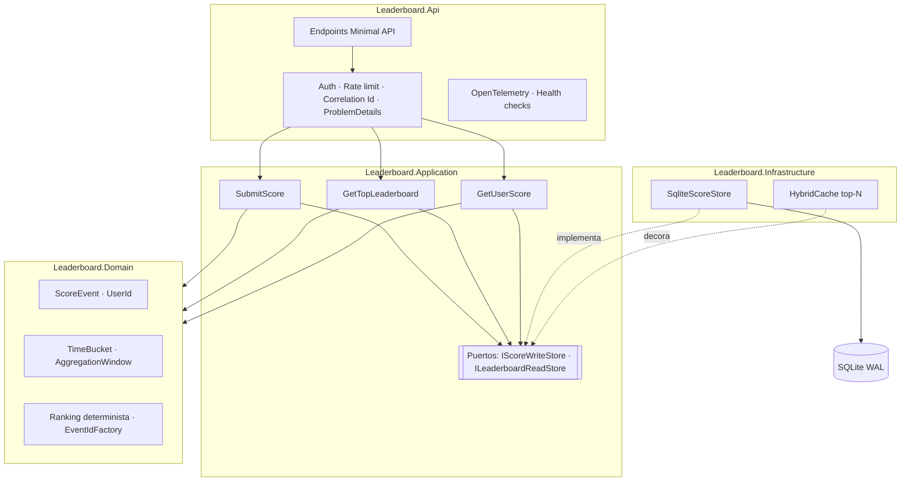
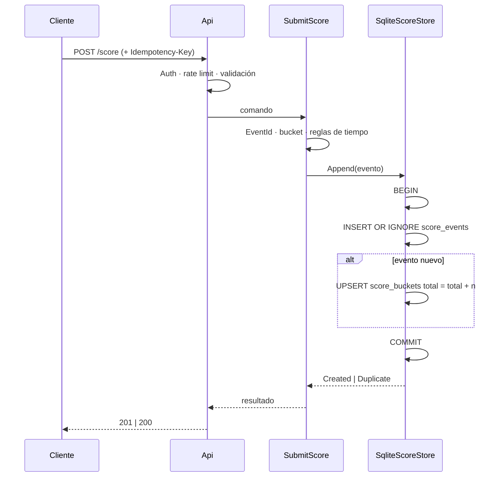
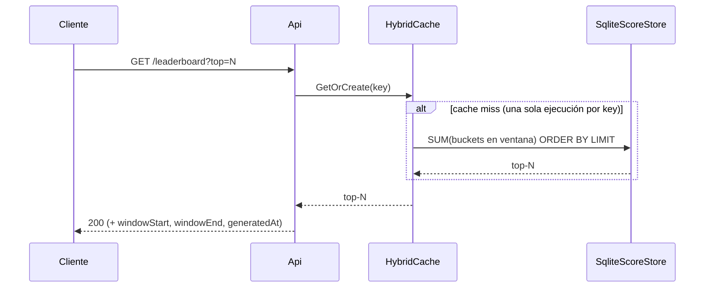

# Arquitectura

<!-- GUÍA: los diagramas deben coincidir con el código final. Revisar al cerrar. -->

## 1. Componentes

| Componente | Responsabilidad |
|---|---|
| _TBD_ | _TBD_ |

## 2. Flujo de escritura: `POST /score`

## 3. Flujo de lectura: `GET /leaderboard?top=N`

## 4. Flujo de lectura: `GET /user/{id}/score`

_TBD_

## 5. Decisiones

Ver [ADR/](ADR/).
