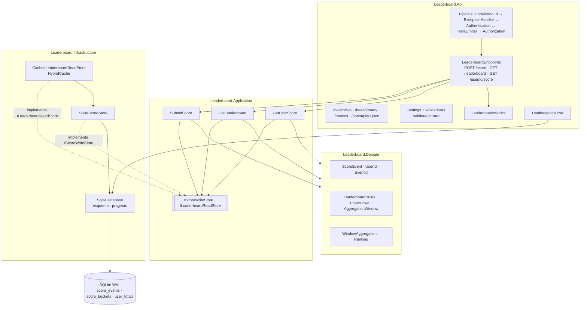
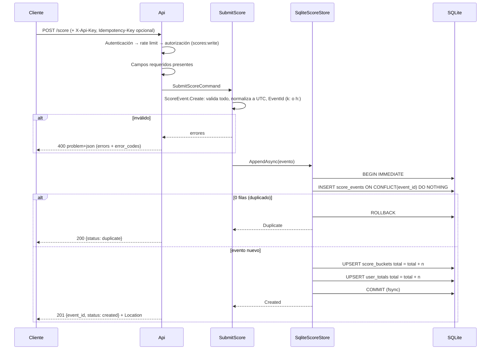

# Arquitectura

Este documento describe el **prototipo implementado**. La arquitectura objetivo para 100k req/s está en [SOLUTION.md §8](../SOLUTION.md#8-escalado-a-100k-reqs), y el registro de decisiones en [ADR/](ADR/).

## 1. Componentes

Regla de dependencias: `Api → Application → Domain` e `Infrastructure → Application`. Domain no depende de nada.



| Componente | Proyecto | Responsabilidad |
|---|---|---|
| `ScoreEvent`, `UserId`, `EventId` | Domain | Invariantes de entrada: charset y longitud de `user_id`, rango de puntos, skew de tiempo, identidad del evento (`k:` key / `h:` hash) |
| `LeaderboardRules` | Domain | Ventana, bucket, skew y tope de puntos, con validación (bucket divisor de un día, ventana múltiplo del bucket) |
| `TimeBucket`, `AggregationWindow` | Domain | Bucketización UTC y ventana `[Start, End)` alineada a buckets |
| `WindowAggregation`, `Ranking` | Domain | Especificación ejecutable de la suma por ventana y del top-N (heap acotado, orden total) |
| `SubmitScore`, `GetLeaderboard`, `GetUserScore` | Application | Casos de uso: orquestan dominio y puertos con un reloj inyectado (`TimeProvider`) |
| `IScoreWriteStore`, `ILeaderboardReadStore` | Application | Puertos con su contrato de consistencia (atomicidad, exactamente-una-vez, snapshot único) |
| `SqliteScoreStore` | Infrastructure | Adaptador SQLite: transacción `IMMEDIATE`, dedupe por PK, incremento en SQL, lecturas en una sola sentencia |
| `SqliteDatabase` | Infrastructure | Conexiones con pooling, pragmas (WAL, `synchronous=FULL`, `busy_timeout`), esquema idempotente |
| `CachedLeaderboardReadStore` | Infrastructure | Decorador de lectura: caché del top-N con TTL y coalescencia de misses |
| `LeaderboardEndpoints`, `Problems`, contratos | Api | HTTP: mapeo de DTOs snake_case, códigos de estado y errores RFC 9457 |
| `ApiKeyAuthenticationHandler` | Api | Autenticación por `X-Api-Key` en tiempo constante; roles `scores:write` y `scores:read` |
| Rate limiter, health checks, OpenTelemetry, `LeaderboardMetrics` | Api | Operación: token bucket por cliente, live/ready, métricas Prometheus, trazas OTLP |
| `DatabaseInitializer` | Api | Crea el esquema antes de aceptar tráfico |

## 2. Flujo de escritura: `POST /score`



## 3. Flujo de lectura: `GET /leaderboard?top=N`

```mermaid
sequenceDiagram
    participant C as Cliente
    participant A as Api
    participant U as GetLeaderboard
    participant H as CachedLeaderboardReadStore
    participant S as SqliteScoreStore
    C->>A: GET /leaderboard?top=N (scores:read)
    A->>U: HandleAsync(top)
    U->>U: Valida top (1..MaxTop); ventana = EndingAt(now)
    U->>H: GetTopAsync(ventana, N)
    H->>H: clave = top:{start}:{end}:{N}
    alt miss (los misses concurrentes de la misma clave se coalescen)
        H->>S: GetTopAsync
        S->>S: SUM(total) por usuario en [start, end), ORDER BY score DESC, user_id, LIMIT N
        S-->>H: LeaderboardSnapshot(entries, AsOf)
    end
    H-->>U: snapshot (vigente hasta CacheTtl)
    U-->>A: LeaderboardView
    A-->>C: 200 {window_start, window_end, generated_at = AsOf, entries}
```

## 4. Flujo de lectura: `GET /user/{id}/score`

```mermaid
sequenceDiagram
    participant C as Cliente
    participant A as Api
    participant U as GetUserScore
    participant S as SqliteScoreStore
    C->>A: GET /user/{id}/score (scores:read)
    A->>U: HandleAsync(id)
    U->>U: UserId.Create(id); ventana = EndingAt(now)
    alt id inválido
        A-->>C: 400 problem+json
    end
    U->>S: GetUserScoreAsync (sin caché: refleja las escrituras propias)
    S->>S: una sentencia: user_totals.total + SUM(buckets en ventana)
    alt nunca envió puntuaciones
        A-->>C: 404 problem+json (user.not_found)
    else
        A-->>C: 200 {user_id, window_score, all_time_score, window_start, window_end}
    end
```

## 5. Decisiones

| ADR | Decisión |
|---|---|
| [001](ADR/001-persistencia-sqlite-wal.md) | SQLite WAL + Dapper; transacción `IMMEDIATE` con incremento en SQL |
| [002](ADR/002-idempotencia-de-escritura.md) | `Idempotency-Key` opcional + hash determinista de respaldo |
| [003](ADR/003-agregacion-por-buckets-temporales.md) | Agregación por buckets temporales alineados |
| [004](ADR/004-cache-del-leaderboard.md) | Caché del top-N con `HybridCache` como mitigación de hot key de lectura |
| [005](ADR/005-estrategia-de-escritura.md) | Escritura síncrona por evento en el prototipo; group commit como evolución |
